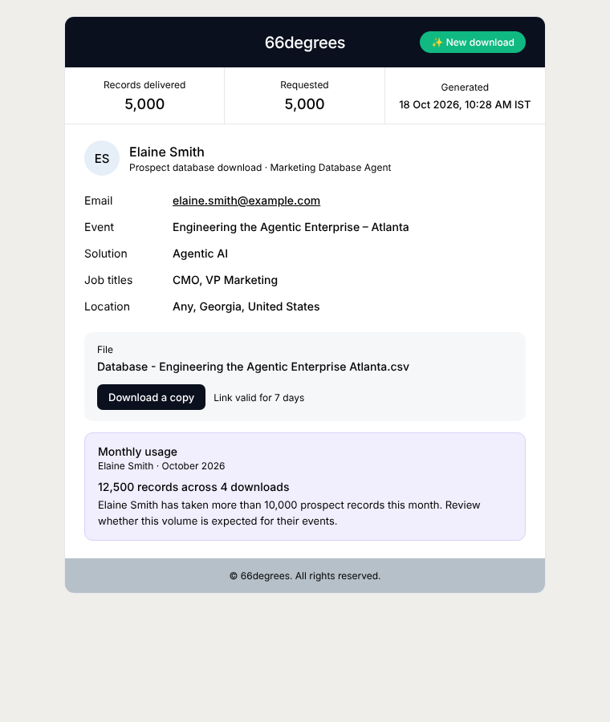
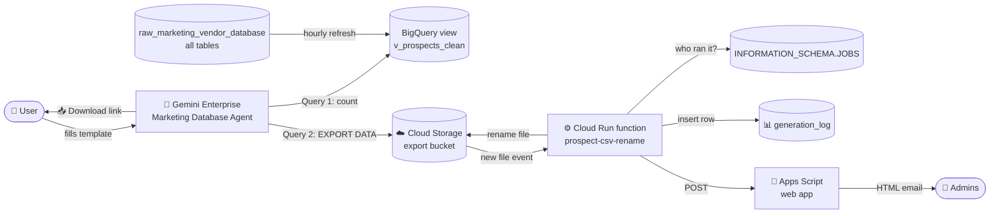

<div align="center">

# 🎯 Marketing Database Agent

### From a chat message to a clean, event-ready prospect list in seconds.

A **Gemini Enterprise** agent that searches a **BigQuery** marketing database, builds a
downloadable prospect CSV, and gives admins a full audit trail of every download.

<br>


**[Examples](examples/EXAMPLES.md)** · **[Configuration](#configuration)** · **[Setup](#setup)** · **[Troubleshooting](docs/TROUBLESHOOTING.md)**

</div>

---

## ✨ Highlights

| | |
|---|---|
| 💬 **Chat-first** | Users fill a simple template in Gemini Enterprise. No forms, no SQL. |
| 📥 **One-click CSV** | A direct download link, saved as `Database - <Event Name>.csv`. No rows clutter the chat. |
| 🧠 **Smart title matching** | Word-boundary matching, so *CTO* never matches *Director*. |
| 🚀 **Solution fill** | Too few matches? Senior titles related to the chosen Solution (Agentic AI, Data & AI, Cloud…) fill the gap. The user's own titles always come first. |
| 🧹 **Clean data** | Valid emails only, duplicates removed across all tables, opted-out contacts excluded. |
| ♾️ **Grows automatically** | Every table uploaded to the dataset is included within an hour. No code changes. |
| 🔔 **Admin alerts** | Every download emails the admins: who, when, how many, for which event. |
| 📊 **Permanent audit log** | One BigQuery row per download, so you can ask "who took how much this month?" |
| 🔒 **Tamper-proof identity** | The user's name comes from BigQuery's own job history, not from the AI. |

---

## 💬 How users use it

```text
🎯 Build a Prospect Database
Event Name:      Cloud Leaders Summit – Texas
Solution:        Data & AI
Database Count:  300            (max 5,000)
Job Title(s):    CIO, CTO
City:            Any
State:           Texas
Country:         United States
```

The agent replies:

```text
✅ Prospect database ready — Cloud Leaders Summit – Texas
Records: 300 of 300 requested
Job titles: CIO, CTO
Location: Any, Texas, United States
📥 Download CSV
✅ All set! Your prospect database is ready. Download your CSV and start prospecting!
```

**CSV columns (11):** Company Name · Website · First Name · Last Name · Job Title · Email ID ·
Industry · Prospect LinkedIn · City · State · Country

> 📚 More scenarios (Solution fill, shortfalls, title matching, SQL, log queries) in
> **[examples/EXAMPLES.md](examples/EXAMPLES.md)**.

---

## 🔔 What admins get

Every generation, by **any** user, automatically triggers:

<table>
<tr>
<td width="55%" valign="top">

**📧 An instant email** to the admins
- user name and email, timestamp
- records delivered vs requested
- event, solution, job titles, location
- a 7-day **Download a copy** button
- the user's **monthly usage** (flags heavy use above 10,000 records)

**🗄️ A permanent log row** in BigQuery
`prospect_agent_logs.generation_log`

</td>
<td width="45%" valign="top">



</td>
</tr>
</table>

---

## 🏗️ Architecture



<details>
<summary><b>Step by step</b></summary>

1. **Agent** collects the 7 fields, then runs two SQL statements through the BigQuery connector:
   a **count**, then an **`EXPORT DATA`** that writes the CSV straight into Cloud Storage.
2. **The view** `v_prospects_clean` unions every table in the source dataset, cleans emails,
   removes duplicates and opt-outs, and fills City/State/Country from fallback columns.
   A stored procedure rebuilds it **every hour**, so new tables join automatically.
3. **The Cloud Run function** fires when the file lands:
   - sets the download name → `Database - <Event Name>.csv`
   - finds the export job in `INFORMATION_SCHEMA.JOBS` (real user and time)
   - counts the actual rows in the file
   - writes a row to `generation_log`
   - calls the **Apps Script** web app, which sends the HTML email
4. Exported files **auto-delete after 7 days**.

</details>

---

## 📁 Repository structure

```text
marketing-database-agent/
├── 🤖 agent/
│   ├── agent_instructions.md      # paste into the agent's Instructions
│   └── starter_prompt.txt         # the "🎯 Build a Prospect Database" chip
├── 🗄️ bigquery/
│   └── setup_auto_view.sh         # clean view over ALL tables + hourly refresh
├── ⚙️ csv-helper/                  # Cloud Run function: rename + log + email
│   ├── index.js
│   ├── package.json
│   ├── deploy_logging.sh
│   └── test_logging.sh
├── 📧 apps-script/
│   └── Code.gs                    # HTML admin email sender (web app)
├── 📚 examples/
│   ├── EXAMPLES.md                # worked examples
│   └── sample_output.csv          # fictional sample output
├── 📄 docs/
│   ├── admin-email-preview.png
│   └── TROUBLESHOOTING.md
└── 🧪 mcp-server-optional/         # built, but blocked by org policy (not in use)
```

---

<a id="configuration"></a>

## ⚙️ Configuration

> 🔐 **This repository is public.** It contains **no** real project IDs, emails, URLs, API keys or secrets.

Replace these placeholders before deploying:

| Placeholder | Replace with | Used in |
|---|---|---|
| `your-gcp-project-id` | Your Google Cloud project ID | all scripts, agent instructions |
| `YOUR_PROJECT_NUMBER` | `gcloud projects describe <id> --format="value(projectNumber)"` | `bigquery/`, `csv-helper/`, `mcp-server-optional/` |
| `admin-one@example.com`, `admin-two@example.com` | Admin emails that receive alerts | `csv-helper/`, `apps-script/Code.gs` |
| `PASTE_YOUR_SECRET_HERE` | `openssl rand -hex 16` | `apps-script/Code.gs` |

<details>
<summary><b>One-command replace</b></summary>

```bash
grep -rlI --exclude-dir=.git -e your-gcp-project-id -e YOUR_PROJECT_NUMBER \
  -e admin-one@example.com -e admin-two@example.com . | xargs sed -i \
  -e 's/your-gcp-project-id/<PROJECT_ID>/g' \
  -e 's/YOUR_PROJECT_NUMBER/<PROJECT_NUMBER>/g' \
  -e 's/admin-one@example.com/<ADMIN_EMAIL_1>/g' \
  -e 's/admin-two@example.com/<ADMIN_EMAIL_2>/g'
```

</details>

The **Apps Script URL** and the **secret** are passed to `deploy_logging.sh` at deploy time and
saved only in a local, git-ignored `env.yaml`. They are never committed.

---

<a id="setup"></a>

## 🚀 Setup from scratch

All commands run in **Cloud Shell**.

**1️⃣ Clean view over all tables**
```bash
cd bigquery && bash setup_auto_view.sh
```

**2️⃣ Export bucket** (skip if it already exists)
```bash
P=your-gcp-project-id; SA=YOUR_PROJECT_NUMBER-compute@developer.gserviceaccount.com
gcloud storage buckets create gs://$P-prospect-exports --location=us-central1 --uniform-bucket-level-access --public-access-prevention
gcloud storage buckets add-iam-policy-binding gs://$P-prospect-exports --member="serviceAccount:$SA" --role="roles/storage.objectAdmin"
gcloud iam service-accounts add-iam-policy-binding $SA --member="serviceAccount:$SA" --role="roles/iam.serviceAccountTokenCreator"
```
Add a 7-day delete lifecycle rule (see `mcp-server-optional/deploy.sh`). On a brand-new project, also
grant `roles/pubsub.publisher` to the Cloud Storage service agent and `roles/eventarc.eventReceiver`
to the runtime service account.

**3️⃣ Email sender** in [script.google.com](https://script.google.com)
- new project → paste `apps-script/Code.gs` → set `SHARED_SECRET`
- run `sendTestEmail` once (authorise)
- **Deploy → New deployment → Web app** · Execute as: *Me* · Access: *Anyone* → copy the URL

**4️⃣ Rename + log + email function**
```bash
cd csv-helper
bash deploy_logging.sh "<APPS_SCRIPT_WEB_APP_URL>" "<SECRET>"
bash test_logging.sh        # exports 25 rows, shows the log row, sends a test email
```

**5️⃣ The agent** (Gemini Enterprise)
- Instructions → paste `agent/agent_instructions.md`
- Starter prompt → paste `agent/starter_prompt.txt`
- Keep the **BigQuery** connector attached

---

## 📊 Admin queries

<details open>
<summary><b>Who took how much this month</b></summary>

```sql
SELECT user_email, COUNT(*) AS downloads, SUM(delivered_count) AS records
FROM `your-gcp-project-id.prospect_agent_logs.generation_log`
WHERE DATE(generated_at, 'Asia/Kolkata') >= DATE_TRUNC(CURRENT_DATE('Asia/Kolkata'), MONTH)
GROUP BY user_email
ORDER BY records DESC;
```
</details>

<details>
<summary><b>Latest 20 generations</b></summary>

```sql
SELECT FORMAT_TIMESTAMP('%d %b %Y %I:%M %p', generated_at, 'Asia/Kolkata') AS time_ist,
       user_email, event_name, solution, requested_count, delivered_count
FROM `your-gcp-project-id.prospect_agent_logs.generation_log`
ORDER BY generated_at DESC
LIMIT 20;
```
</details>

<details>
<summary><b>Rebuild the view right now (after uploading a new table)</b></summary>

```sql
CALL `your-gcp-project-id.raw_marketing_vendor_database.refresh_prospect_view`();
```
</details>

More in **[examples/EXAMPLES.md](examples/EXAMPLES.md#10-the-log-table)**.

---

## 🧱 Google Cloud resources

| Resource | Name |
|---|---|
| 🗄️ Source dataset | `raw_marketing_vendor_database` (all current and future tables) |
| 🧹 Clean view | `v_prospects_clean` |
| 🔁 Refresh | procedure `refresh_prospect_view` + scheduled query "Refresh prospect view" (hourly) |
| ☁️ Export bucket | `<project>-prospect-exports` (7-day auto-delete) |
| 📊 Log table | `prospect_agent_logs.generation_log` |
| ⚙️ Cloud Run function | `prospect-csv-rename` (us-central1, bucket trigger) |
| 📧 Apps Script | "Prospect Database Admin Emails" (web app) |

---

## ⚠️ Known limits

- Maximum **5,000** records per request.
- Users need BigQuery access (Job User + Data Viewer) and read/create access to the export bucket.
- Gmail can't load the Lexend web font, so the email falls back to Gmail's default font.
- Custom MCP connectors are blocked by the org policy, see [`mcp-server-optional/`](mcp-server-optional/README.md).

Hit a problem? See **[docs/TROUBLESHOOTING.md](docs/TROUBLESHOOTING.md)**.

---

<div align="center">

Built by **Deepanjan Dasgupta** & **Neelkant Ekbote**

</div>
